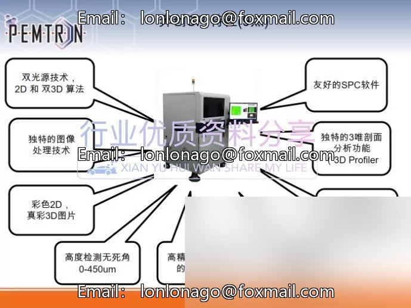
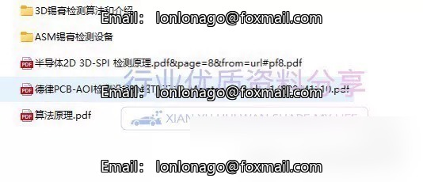
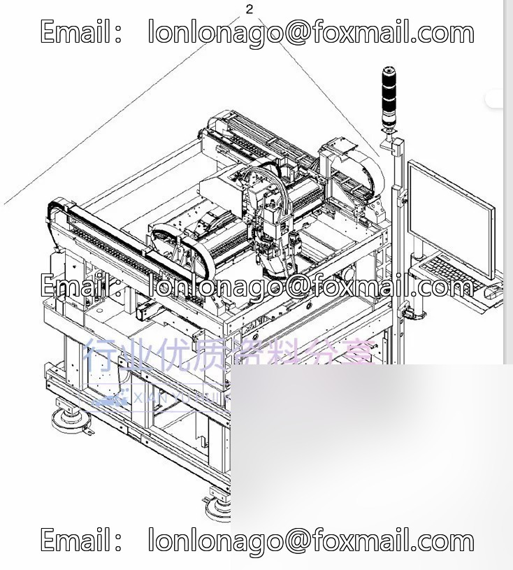
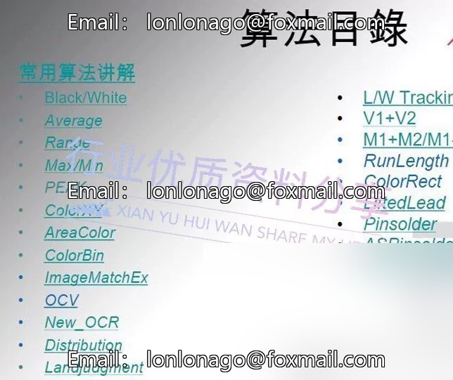
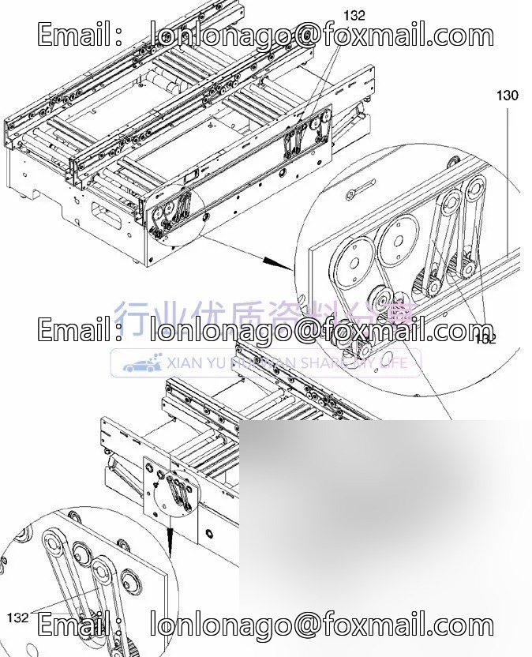

# # Materials: Semiconductor industry visual inspection equipment, including ASM, PEMTRN, and TR

## Body

# Materials for semiconductors industry vision detection equipment, including ASM, PEMTRN, and TRI, which include algorithm introductions and specifications as well as exploded views,

Take a photo and immediately send the electronic original file! The following images are screenshots of the file directory. Confirm before placing the order! Due to the replicability of electronic filing materials, So after purchase, returns are not allowed! Thanks for understanding!

The materials cover semiconductor industry visual inspection equipment including ASM, PEMTRN and TR, with algorithm introductions, instructions, an ASM explosion diagram, electronic original files, and a note that the image contains a file directory screenshot requiring confirmation.

<!-- AI_ENRICHED -->

## Images

## Payment

Here is a pay link on Stripe ( https://buy.stripe.com/3cs8yP7sY87d0vu9AB ). Please contact me lonlonago@foxmail.com after funding $89, and I will send you a complete data files , thank you!

